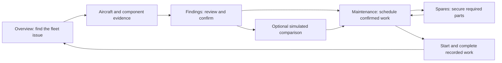

# Maintenance decision user flow

## Fleet operations

The default `/` and `/home` open `/dashboard`. The optional `/welcome` explains the workflow and offers role-specific starting points. Choosing a role does not grant server permissions.

| Workspace | Responsibility | Handoff |
|---|---|---|
| `/dashboard` | Availability, forecast, urgent findings and recorded grounding reasons | Aircraft, findings or maintenance |
| `/aircraft`, `/aircraft/:id` | Fleet register and integrated model, blueprint, component records, history and advisories | Findings and maintenance scoped to the aircraft |
| `/health/:id` | Component identity, quality, sensor evidence, uncertainty and finding decision | Findings, maintenance or simulator with component context |
| `/advisories` | One searchable/filterable findings queue; review proposed findings before scheduling accepted ones | Scoped maintenance work board |
| `/maintenance` | Work board with readiness/action controls; Bays & timeline; read-only Work register | Scoped supply requests, recorded work, fleet outcome |
| `/spares` | Inventory & demand with part deep links; Parts requests for reservation, orders and receipts | Scoped maintenance work board |
| `/simulator` | Optional explicitly simulated comparison | Maintenance or dashboard; results do not complete work |
| `/notifications` | Acknowledgement of operational alerts | Findings or work; acknowledgement is not resolution |
| `/analytics`, `/data` | Supporting evaluation and source/integration evidence | Findings, data or reports |

Aircraft/component query parameters remain attached to related workflow links. Findings, work board and supply requests filter their records. Fleet-wide inventory, bay and archive views label the aggregate scope; the user can clear selection. Mandatory aircraft tasks remain visible and are not hidden by a component-only filter. Scheduling, work lifecycle and stock mutations retain existing server authorization and readiness checks. The archive links to the work board instead of offering a competing set of mutations.

## Engine research and trials

The Research menu and `/research` give the engine dataset its own context. `/fleet/register` selects a record; `/components/:id` reviews saved estimate/quality/sensor evidence; `/planning` calculates a constraint proposal and reviews the exact version for authorized approval. `/inventory` retains deliveries/reservations; `/scenarios` retains saved matched simulations; `/alerts` and `/ai` support evidence. `/fleet` is the alternate spatial inspector. `/demo` retains entered cases, assessments, scoped proposals, supply simulation, approval and work outcomes described in [customer trial](customer_trial.md).

These tools use separate engine records and cutoffs, independent of fleet replay. A component link into the general research planner retains context but does not restrict its fleet-wide solver; the page states that boundary. A research result does not update the operational fleet's simulated health records.

## Consolidated entry points

| Old URL | Canonical destination |
|---|---|
| `/review` | `/advisories?status=proposed` |
| `/plan` | `/maintenance?view=work` |
| `/parts` | `/spares?view=requests` |
| `/status` | `/dashboard#grounded` |
| `/overview` | `/welcome` |

Redirects preserve query context and incoming anchors. The duplicate card queue, duplicate status charts, marketing start page and unused alternate application shell have been removed. Primary, mobile and search navigation share one route inventory. More contains supporting operational tools; Research contains its separate tools. Related steps give each page a purposeful return path.

## Exceptions and evidence boundaries

Unavailable input/model/API states must not become healthy or zero-count substitutes. Unknown or infeasible proposals are not approvable; stale approvals require fresh calculation and review. Supply and record mutations retain actual quantities and versions. Read-only users can inspect evidence without gaining mutation permissions. An empty work board proves only that no work is recorded. Forecasts and scenario outputs are projections, not measured improvements or clearance.

Browser verification checks routes, context, keyboard controls and state transitions. Participant comprehension and qualified operational/scientific acceptance remain unproven. General task editing and richer multi-component research-register selection remain separate improvements.
