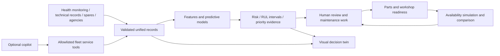

# FleetAvail — SIH presentation preparation

Reviewed 12 October 2026 against repository revision `da96d4a`. Repository: `pallavpushkar3-gif/sih-project`. This is a source and live website review, not a new operational or scientific acceptance report.

## The main message

**FleetAvail connects aircraft health predictions with maintenance work, spare availability and workshop capacity so teams can act before a predicted failure becomes avoidable downtime.**

The supplied PS 26249 describes fragmented, reactive maintenance and inadequate integration of health-monitoring data, technical records, spares and maintenance agencies. Prediction alone is insufficient: a team also needs the right part, a maintenance slot and a human decision. That connection is the presentation's strongest product story.

Current website brand: **FleetAvail**. Use it consistently in the slides and screenshots.

## Problem statement → implemented solution

| Problem / opportunity | Current product behaviour | Evidence / demo destination | Boundary |
|---|---|---|---|
| Fragmented data | Unified aircraft → system → component → part relationships; source quality and ingestion validation | `/data` | Four synthetic source extracts; ingestion stores validated readings and batches. Do not claim uploaded readings automatically retrain or update the active model bundle. |
| Delayed fault prediction | Anomaly indicators, 14/30-day failure probabilities and remaining-life ranges | `/health/AC-008-ENG-TRB`, `/advisories` | Learned models operate on simulated data; estimates can have low confidence. |
| Poor visibility of condition | Aircraft showroom, blueprint, component register, conceptual structures and history replay | `/aircraft/AC-008`, `/aircraft/AC-033` | Five authored visual airframe classes; geometry, component placements and internal structures are illustrative, not validated OEM CAD or physical fault localization. |
| Reactive maintenance | Confirm findings, schedule work, inspect readiness, start and complete recorded work | `/advisories` → `/maintenance` | Human decisions and server checks remain necessary. No aircraft clearance authority. |
| Waiting for spares | Stock/demand comparison, shortfalls, lead-time versus RUL, requests/reservations/orders/receipts | `/spares`, `/spares?view=requests` | Synthetic logistics. Printable-part routes are assumed demo options, not certified manufacturing capability. |
| Workshop bottlenecks | Bays, agency allocation, queues and timelines | `/maintenance?view=bays` | Demonstration capacities and durations, not a qualified operational resource model. |
| Sub-optimal fleet availability | Current availability, grounding causes, forecast intervals and what-if comparisons | `/dashboard`, `/simulator` | Monte Carlo projections; not measured fleet improvement. |
| Difficult interpretation | Optional conversational copilot grounded through allowlisted service tools and record citations | “Ask AI” | Integrated but **unavailable in the reviewed local run** because Ollama is unreachable. Traceability checks are heuristic, not a guarantee against incorrect answers. |

## Exactly what AI does

There are two separate AI layers. Keep them distinct in the PPT.

**Predictive maintenance engine:**

- Condition-normalized sensor features and residual statistics.
- Isolation Forest plus residual/sustained-signal checks for anomalies.
- Scikit-learn histogram gradient-boosting classifiers for 14/30-day failure risk, with isotonic calibration.
- Quantile gradient-boosting regressors for remaining useful life, with split-conformal interval widening and a 60-day cap.
- Occlusion-based attribution to show which feature groups influence predicted risk. This describes model behaviour; it does not establish a mechanical cause.
- A separate versioned rule assigns P1–P4 priority using risk, component criticality, remaining life, spare shortfall and availability impact. The priority rule is not an LLM prediction.

**Maintenance copilot:** an optional Qwen3-8B model through Ollama. It calls approved tools wrapping existing fleet services to retrieve records and, for eligible roles, create separate simulated what-if runs. It does not replace the predictive models or automatically approve maintenance. On this machine `/api/assistant/status` reported `enabled: true`, `available: false`.

Do not describe the entire product as a chatbot. The predictive and planning workflows function without the copilot.

## Two workspaces — an important distinction

1. **Fleet operations:** the synthetic whole-fleet workspace, visual twins, component risk, findings, maintenance work board, spares and Monte Carlo availability simulation.
2. **Engine research/customer trial:** public NASA C-MAPSS FD001 simulated histories, engine-life assessments, OR-Tools CP-SAT proposals, independent constraint checks, transactional approval/reservations and the entered-case trial at `/demo`.

The research lab remains available through `/research`. Its records and cutoffs are separate from fleet replay. Do not imply that every fleet maintenance-board action runs the research CP-SAT solver, or that a research result updates fleet health. The installed customer-trial catalogue reported a calibrated baseline/sample available; a new end-to-end trial was not executed in this review.

## Demonstration narrative

Use one aircraft/component consistently when explaining prediction, and a separate labelled case for an already-failed component.

1. **Overview:** open `/dashboard`. Explain current availability, projected availability and why aircraft are grounded.
2. **Predictive case:** open `/aircraft/AC-008`, then `/health/AC-008-ENG-TRB`. Explain the turbine's sensor evidence, risk, life interval, confidence and required spare.
3. **Findings:** open `/advisories?component=AC-008-ENG-TRB`. Explain review/confirmation before scheduling. The reviewed finding was still proposed; no confirmation was performed.
4. **Maintenance:** follow the scoped link to `/maintenance?component=AC-008-ENG-TRB`. Explain readiness and the work lifecycle without presenting unconfirmed work as scheduled.
5. **Supply:** inspect `/spares` and scoped requests. Show that a part in stock today can still have a fleet-wide shortfall.
6. **Impact:** open `/simulator`. Explain baseline-versus-intervention comparison, uncertainty and the separation between simulated results and committed work. A new scenario was not run during this review.
7. **Visual inspection case:** use `/aircraft/AC-033` for the failed turbine highlighted in the blueprint and its conceptual 3D structure. This is an already-failed component, not the early-warning example.

## Real values available for illustration

These are **synthetic snapshot values**, as of **30 September 2026**, retrieved on 12 October. They are not live operational figures.

| Example | Value | Correct interpretation |
|---|---|---|
| Fleet size | 40 aircraft | Demonstration fleet |
| Available | 33/40 = 82.5% | Current synthetic snapshot, often rounded to 83% in the UI |
| Open P1/P2 findings | 8 + 10 = 18 | Review workload, not 18 proven imminent failures |
| Open work orders | 6 | Recorded backlog |
| 30-day mean availability | 78.37%, P10–P90 74.67%–82.08% | Projection from 300 Monte Carlo runs |
| AC-008 turbine risk | 86.67% over 14 days | Individual predicted probability, **not model accuracy** |
| AC-008 turbine RUL | P10/P50/P90 = 0/9/44 days | Wide interval; confidence is low |
| Required turbine spare | PRP-230: 1 available, projected 30-day fleet demand 2 | Stock today does not guarantee adequate future supply |

Retained fleet model run: `fe-079f8f8e15124ed3`, seed `42`, created 7 October 2026. The application was rebuilt from the latest revision; this existing model bundle was retained, not retrained during review. API outputs and manifest context are captured in the local evidence file.

## Evaluation — use with the limitations

The existing artifact reports a temporal split with eight aircraft entirely held out. These are synthetic evaluation results, retrieved from `/api/fleet-health/models`; this review did not repeat training or scientific evaluation.

| Metric | Model | Baseline / limitation |
|---|---:|---|
| 14-day risk PR-AUC | 0.7851 | Logistic baseline 0.7593; PR-AUC is not percentage accuracy |
| RUL MAE, all evaluated rows | 1.11 days | Linear baseline 1.24 days; many rows are at the capped lifetime |
| RUL MAE near failure | 13.03 days | Linear baseline 19.87 days |
| P10–P90 coverage near failure | 63.95% | Below the 80% nominal level; an important unresolved limitation |
| Anomaly episode recall | 63.04% | Rolling-z baseline 100%; ML trades recall for fewer false alarms in this experiment |

Do not use “97% accurate” based on the overall interval-coverage figure. Do not claim measured downtime savings, real defence-fleet validation, certified 3D geometry, certified printed parts, autonomous aircraft clearance or a hallucination-free assistant.

## Suggested PPT structure

This is a suggested narrative, **not a verified SIH slide-count/template requirement**.

1. **Idea and problem:** fragmented maintenance causes preventable downtime; state PS 26249 and the integrated decision proposition.
2. **Solution and user flow:** health evidence → finding → human review → work readiness → parts/workshop → projected availability. Include the dashboard and one aircraft image.
3. **Technical approach:** show the architecture below; distinguish prediction, priority rules, simulation and the optional copilot.
4. **Prototype and feasibility:** live twin/blueprint/component evidence; local service stack and role checks; honest synthetic evaluation and its weaknesses.
5. **Impact and adoption:** proposed benefits—earlier review, unified records and coordinated resources. Explain how a real pilot would measure downtime, warning quality, spare waits and adoption; do not substitute simulation results for measured savings.
6. **Evidence and next steps:** screenshots, dataset/model provenance, real-data integration and validation, deployment availability, and operational qualification boundaries.

Technology: React/TypeScript/Vite, Three.js/React Three Fiber, ECharts, FastAPI, PostgreSQL, scikit-learn, Celery/RabbitMQ/outbox. The engine research workspace additionally contains OR-Tools CP-SAT and SimPy reference scenarios.

## Screenshots and review evidence

Local directory: `artifacts/sih-review-20261012/`. Suggested presentation images:

| Image | Use |
|---|---|
| `dashboard.png` | Fleet-level problem and current state |
| `predictive-aircraft-AC008.png` | Matched early-warning aircraft example |
| `predictive-turbine-AC008.png` | Sensor/risk/RUL evidence for that same example |
| `aircraft-twin.png` | AC-033 visual showroom, already-failed case |
| `aircraft-blueprint.png` | Component mapping and highlighted failed turbine |
| `component-structure.png` | Conceptual internal assembly inspection |
| `findings.png`, `maintenance.png`, `bays.png` | Human workflow and workshop constraints |
| `spares.png`, `part-requests.png` | Inventory intelligence and supply readiness |
| `analytics.png`, `data-integration.png` | Evaluation and integration provenance |
| `dashboard-mobile.png` | Mobile layout |
| `copilot.png` | Integrated assistant's honest unavailable state; not an answer demonstration |

`evidence.json` retains API responses, page headings, alerts, text samples and browser exceptions. `public-link.json` records the public-link check. Captures are actual local screens, not mockups. Retain a visible “synthetic / illustrative / simulated” caption when putting cropped images in the PPT.

## Verification and remaining demo blockers

- Git pulled fast-forward from `7a87c94` to `da96d4a`; source/UI was not redesigned in this review.
- All six local Compose services started and passed the configured readiness checks.
- Fourteen website destinations were opened, including research/customer-trial entry points. Blueprint/component structure, copilot panel and the mobile dashboard were inspected. No browser page exceptions or main-content alerts were recorded; the dashboard fits a 390px mobile viewport.
- `make web-check` passed frontend lint, TypeScript, production build and **24 tests across six files**. The stale temporary Corepack cache initially failed; a fresh temporary cache resolved it. Large chart/3D chunk warnings remain.
- The public GitHub Pages product link currently displays **“Demo backend offline.”** The page loads, but its demo API is unreachable. Use local rehearsal/screenshots or restore the existing host/tunnel before relying on that link for judging.
- The optional Ollama copilot model service is unavailable locally. No LLM answer was generated or verified.
- No new maintenance approvals, stock mutations, scenario runs, ingestion batches or customer trials were created. No comprehensive backend/security/science release gate was rerun. This is a working demonstrator review, not a production-readiness declaration.
